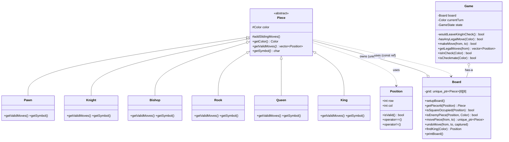
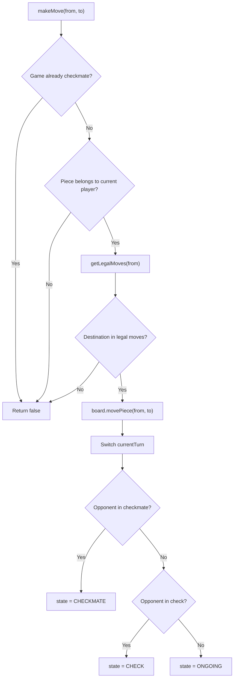

# Chess OOP Project — Full Explanation

## Overview

This is a **console-based Chess game** written in **C++** that demonstrates core **Object-Oriented Programming (OOP)** concepts — inheritance, polymorphism, abstraction, and encapsulation. Two human players take turns entering moves in algebraic notation (e.g. `e2 e4`), and the game enforces all standard chess movement rules, check detection, and checkmate.

---

## Architecture Diagram

---

## File-by-File Breakdown

### 1. [`Position.h`](file:///c:/web%20development/github_repos/chess/chess_oops/Position.h) — Coordinate struct

| What | Details |
|---|---|
| **Purpose** | Simple `{row, col}` struct representing a square on the 8×8 board |
| **Key logic** | `isValid()` — bounds-checks that row/col are in `[0, 7]` |
| **OOP concept** | **Operator overloading** (`==`, `!=`) |

Row 0 = rank 8 (top, Black's back rank); Row 7 = rank 1 (bottom, White's back rank).

---

### 2. [`Piece.h`](file:///c:/web%20development/github_repos/chess/chess_oops/Piece.h) — Abstract base class + 6 derived piece classes

| What | Details |
|---|---|
| **Purpose** | Defines the `Piece` **abstract base class** and all 6 concrete pieces |
| **Key OOP concepts** | **Abstraction** (pure virtual `getValidMoves`, `getSymbol`), **Inheritance** (each piece extends `Piece`), **Encapsulation** (`color` is `protected`) |

**Class hierarchy:**

| Class | Symbol (W/B) | Movement strategy |
|---|---|---|
| `Pawn` | `P` / `p` | Forward 1 (or 2 from start), diagonal capture |
| `Knight` | `N` / `n` | L-shaped jumps (8 offsets) |
| `Bishop` | `B` / `b` | Diagonal sliding |
| `Rook` | `R` / `r` | Horizontal/vertical sliding |
| `Queen` | `Q` / `q` | All 8 directions (rook + bishop combined) |
| `King` | `K` / `k` | One square in any direction |

---

### 3. [`Piece.cpp`](file:///c:/web%20development/github_repos/chess/chess_oops/Piece.cpp) — Movement logic implementations

| What | Details |
|---|---|
| **Purpose** | Implements `getValidMoves()` for every piece type |
| **Key pattern** | **Sliding move reuse** — the `addSlidingMoves()` helper is shared by Rook, Bishop, and Queen |

**Core algorithms:**

- **`addSlidingMoves()`** — walks from a starting position in a direction `(dRow, dCol)` until hitting the board edge or another piece. If the blocker is an enemy, it's included as a capture. This is the **Template Method** pattern in action.
- **Pawn** — special logic: forward-only, double-move from start row, diagonal-only captures.
- **Knight** — hardcoded 8 L-shaped offset pairs; skips occupied-by-friendly squares.
- **King** — 8 adjacent squares, same friendly-piece filtering.

> [!IMPORTANT]
> These are **pseudo-legal** moves — they don't yet account for leaving your own king in check. That filtering happens in the `Game` class.

---

### 4. [`Board.h`](file:///c:/web%20development/github_repos/chess/chess_oops/Board.h) / [`Board.cpp`](file:///c:/web%20development/github_repos/chess/chess_oops/Board.cpp) — Board state management

| What | Details |
|---|---|
| **Purpose** | Manages the 8×8 grid of pieces using `unique_ptr<Piece>` for ownership |
| **Key OOP concepts** | **Encapsulation** (private grid), **Polymorphism** (stores pieces through base-class pointers), **RAII** (`unique_ptr` auto-cleans memory) |

**Key methods:**

| Method | Logic |
|---|---|
| `setupBoard()` | Clears the grid, then places all 32 pieces using `makeBackRankPiece()` helper |
| `getPieceAt(pos)` | Returns raw pointer (or `nullptr`); bounds-checked |
| `movePiece(from, to)` | Transfers ownership via `std::move`, returns the captured piece |
| `undoMove(from, to, captured)` | Reverses a `movePiece` — essential for the simulate-then-undo check-detection pattern |
| `findKing(color)` | Linear scan with `dynamic_cast<King*>` (RTTI) |
| `printBoard()` | ASCII rendering with file labels (a–h) and rank numbers (1–8) |

---

### 5. [`Game.h`](file:///c:/web%20development/github_repos/chess/chess_oops/Game.h) / [`Game.cpp`](file:///c:/web%20development/github_repos/chess/chess_oops/Game.cpp) — Game rules engine

| What | Details |
|---|---|
| **Purpose** | Orchestrates turns, validates legality, detects check/checkmate |
| **Key OOP concepts** | **Encapsulation** (private helpers `wouldLeaveKingInCheck`, `hasAnyLegalMove`), **Composition** (owns a `Board`) |

**Core logic flow for `makeMove(from, to)`:**

**Key algorithms:**

| Method | What it does |
|---|---|
| `isInCheck(color)` | Scans all enemy pieces and checks if any can reach the king's square |
| `wouldLeaveKingInCheck(from, to)` | **Simulate → Test → Undo** pattern: temporarily executes the move, checks if the mover's king is attacked, then reverses the move |
| `getLegalMoves(from)` | Filters pseudo-legal moves by removing any that would leave the king in check |
| `hasAnyLegalMove(color)` | Scans all pieces of `color` — returns `true` as soon as any piece has ≥1 legal move |
| `isCheckmate(color)` | `isInCheck(color) && !hasAnyLegalMove(color)` |

---

### 6. [`main.cpp`](file:///c:/web%20development/github_repos/chess/chess_oops/main.cpp) — Console UI / game loop

| What | Details |
|---|---|
| **Purpose** | Text-based input/output loop for two human players |
| **Key logic** | `parseSquare()` converts algebraic notation (e.g. `"e2"`) to a `Position` struct |

**Game loop:**
1. Print the board
2. Show "Check!" if applicable
3. Prompt the current player for `from` and `to` squares
4. Parse input → validate → execute via `game.makeMove()`
5. On checkmate, announce the winner and exit

---

## OOP Concepts Used

| Concept | Where it's used |
|---|---|
| **Abstraction** | `Piece` is abstract with pure virtual `getValidMoves()` and `getSymbol()` |
| **Inheritance** | 6 piece classes inherit from `Piece` |
| **Polymorphism** | Board stores `unique_ptr<Piece>` — calls to `getValidMoves()` dispatch to the correct piece type at runtime |
| **Encapsulation** | Private data members (`grid`, `currentTurn`, `state`), public interfaces |
| **Operator overloading** | `Position::operator==`, `operator<<` for `Board` |
| **RTTI** | `dynamic_cast<King*>` in `findKing()` |
| **Smart pointers** | `unique_ptr<Piece>` for automatic memory management (no `new`/`delete`) |
| **Composition** | `Game` has-a `Board`, `Board` has-a grid of `Piece` pointers |

---

## What's NOT Implemented

| Feature | Status |
|---|---|
| Castling | ❌ |
| En passant | ❌ |
| Pawn promotion | ❌ |
| Stalemate detection | ❌ (only checkmate) |
| Draw conditions (50-move, repetition) | ❌ |
| AI opponent | ❌ (two-player only) |
